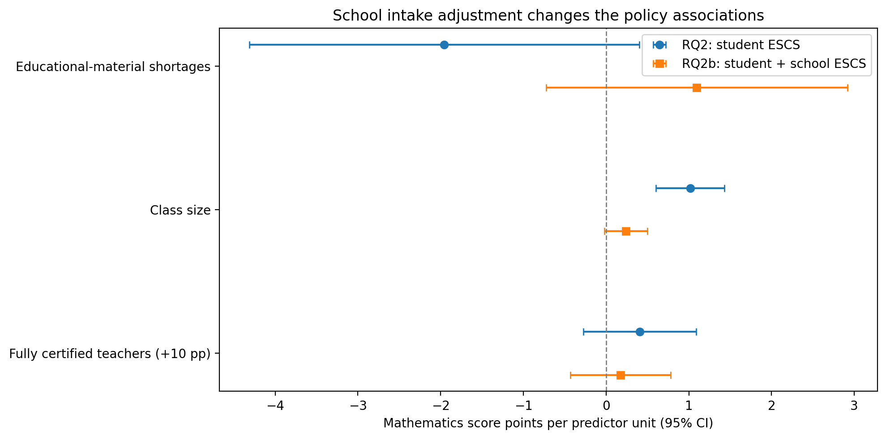
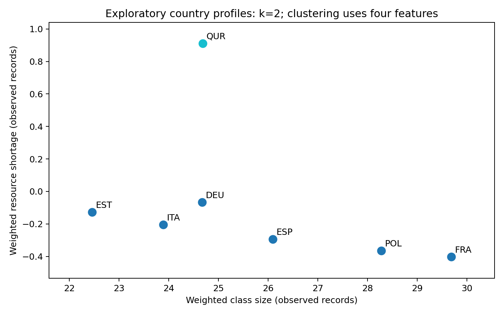

# School resources and mathematics performance in PISA 2022

Data Analytics Final Project · 12 November 2026

## 1 Policy question and team contributions

A ministry can invest in equipment, smaller classes or better-trained teachers. We ask which school-level indicators are associated with mathematics performance, whether those associations remain after socioeconomic adjustment, whether linear regression and Random Forest agree, and whether the selected systems form recognizable groups. Our analysis covers 70,517 students in 2,449 schools across seven education systems.

The results do not establish a causal spending winner. The positive class-size association becomes small and statistically inconclusive after accounting for school intake. In matched prediction exercises, linear regression outperforms the specified Random Forest on three school splits, while both rely strongly on socioeconomic background. Country clustering mainly identifies the Ukrainian regions as an outlying resource/background profile.

| Member | Responsibility and contribution |
|---|---|
| Danylo, pipeline lead | Prepared data ingestion, school–student merging, cleaning, missing-value flags and the processed dataset. |
| Dario | Produced RQ1/RQ2 survey regression and robustness analyses. |
| Ezzeldin A. Fekry | Produced the original RQ3/RQ4 modelling notebook and result exports. |
| Alex | Prepared initial interpretation materials, limitations, hypotheses, dictionary and country context. |
| Danylo Redko | Project Lead, Integration and Results Synthesis: compiled all workstreams, checked consistency, coordinated corrections and integrated the report and presentation narrative. |

Danylo Redko’s contribution extended beyond assisting Alex. He brought together the pipeline, statistical models, machine-learning outputs and interpretation documents; checked alignment with the Data Analytics brief; reconciled samples, variables and methods; and connected the four questions into one account. Interpretation was developed jointly with Alex. The original modelling work remains credited to its specialist authors.

The integration stage used Codex assistance to audit files, implement corrections, rerun models and document checks. This assistance is declared separately rather than attributed as independently authored code by the project lead. The contribution statement records the team-reported assignments and the project lead’s description of his coordination work.

## 2 Data preparation and measurement

The team’s pipeline joins OECD PISA 2022 student and school questionnaire records using CNT and CNTSCHID, with a many-to-one school merge check. It retains all ten mathematics plausible values, the final student weight, 80 replicate weights and missing-value flags. School-average ESCS is calculated from observed student ESCS before student-level imputation. School variables are filled using country medians with a pooled fallback; individual ESCS is similarly filled and flagged.

The preparation file contains 121,564 students, 4,347 schools and 111 columns from fourteen systems. The agreed common analytical subset contains Germany, Estonia, Spain, France, Italy, Poland and Ukrainian regions (18 of 27), coded QUR. The same seven-system scope is used for RQ1–RQ4. These are selected systems, not a representative sample of Europe. The reviewed Parquet was retained unchanged; its exact hash is recorded in the data manifest.

| Field | Meaning in this project |
|---|---|
| CNT and CNTSCHID | System and school identifiers used together for merging. |
| SCHOOL_GROUP_ID | Composite school identifier used to keep schools separate across train and test. |
| PV1MATH–PV10MATH | Ten draws representing uncertainty in latent mathematics proficiency. |
| EDUSHORT | Principal-reported material/infrastructure shortage; higher means more shortage. |
| CLSIZE | Banded school class-size measure; not each student’s actual mathematics class. |
| PROATCE | Proportion of fully certified teachers, measured from zero to one. |
| PROATCE_10PP | PROATCE × 10; one unit is ten percentage points of certification. |
| ESCS | Individual economic, social and cultural background index. |
| SCH_ESCS | Mean observed ESCS of sampled students within a school; an intake indicator. |
| W_FSTUWT / SENWT | Final student weight and equal-country rescaling, respectively. |
| W_FSTURWT1–80 | Replicate weights used to estimate sampling uncertainty. |
| *_imputed | Flag identifying an originally missing value replaced in preparation. |

These indicators are proxies for policy options, not measures of an intervention. Certification does not measure teacher-development quality, perceived shortage does not measure expenditure, and class size is coarsely recorded. STAFFSHORT measures lack of staff, not qualification; it is excluded from the corrected main models. Its Estonian values are entirely imputed, which also makes it unsuitable for the primary seven-system clustering.

## 3 Analytical strategy and model evaluation

### Survey regression for RQ1 and RQ2

RQ1 regresses mathematics plausible values on EDUSHORT, CLSIZE and PROATCE_10PP, with country fixed effects. RQ2 adds student ESCS. RQ2b separately adds SCH_ESCS to examine school-intake composition. The main weights rescale W_FSTUWT so each system contributes equally. Country effects make the common slopes conditional on differences in average levels between systems; they do not remove unobserved differences within systems.

Each regression is estimated for all ten plausible values. For each value, sampling variance is calculated from 80 Fay-BRR replicates per independent system, applying one country’s replicate perturbation at a time and holding other countries’ full weights fixed. Replicate weights receive the same country-scale factors as the main weights. Estimates are averaged across plausible values; mean sampling variance is combined with the adjusted between-value variance. Intervals and p-values use a normal approximation. This follows the need to account for both survey design and proficiency uncertainty described in OECD research documentation [1, 2].

### Matched prediction for RQ3

Linear regression and Random Forest use EDUSHORT, CLSIZE, PROATCE_10PP, ESCS, SCH_ESCS and country indicators, with equal-country training and testing weights. A second specification omits SCH_ESCS to align with RQ2, while a population-weight sensitivity uses W_FSTUWT. The comparison uses 80/20 school-group splits with seeds 42, 7 and 2026. On the primary split, 56,029 students are in training and 14,488 in testing; no school appears in both.

Original missingness is recovered using the flags. Imputation medians are fitted on training data only, counting each school once for school variables. School ESCS is calculated from observed background within the school, so prediction assumes intake information is available for new schools. Both models are fitted separately to all ten plausible values. Random Forest retains fixed settings of 100 trees and minimum leaf size five; it is not selected or tuned against test results. Overall and country-specific training-mean predictions provide baselines.

We report weighted mean absolute error (MAE) and R² averaged over the ten fits. Importance is the increase in held-out weighted MAE after within-country permutation: school features are swapped at school level, ESCS at student level. Three repeats per plausible value are used on seed 42. These measures describe predictive use, not causal effects; correlated features may substitute for each other [3].

### Exploratory country grouping for RQ4

Country means of the three resource proxies and ESCS use W_FSTUWT and exclude flagged imputed values separately for each feature. The four means are standardized across countries, followed by K-means for k = 2, 3 and 4. We compare silhouette scores, alternative initializations, Ward clustering, omission of individual features, exclusion of QUR and prepared-versus-observed means. Because only seven points are available, these are descriptive diagnostics, not independent validation.

## 4 Regression results and interpretation

Table 1 reports mathematics-point coefficients. All models contain country fixed effects and use the same 70,517 students. Certification coefficients represent a ten-percentage-point increase; the coefficients therefore cannot be ranked by raw magnitude against differently scaled predictors.

| Predictor | RQ1 | RQ2 | RQ2b |
|---|---|---|---|
| EDUSHORT | −4.051 | −1.955 | +1.097 |
| CLSIZE | +1.532 | +1.017 | +0.241 |
| PROATCE_10PP | +0.575 | +0.406 | +0.176 |
| Student ESCS | — | +37.379 | +17.994 |
| School ESCS | — | — | +71.765 |

*Table 1. Pooled coefficients across ten plausible values. Full survey standard errors and confidence intervals are supplied in the companion results.*



*Figure 1. Policy associations before and after school-intake adjustment. Bars show approximate 95% survey/PV confidence intervals; each row has its own predictor unit.*

In RQ1, material shortage is negatively associated with scores (95% CI −7.124 to −0.978). After student ESCS is included, its coefficient is −1.955 and the interval includes zero (−4.311 to +0.400). Certification is positive but imprecise in both models. Class size remains positive in RQ2, with a coefficient of +1.017 per student (95% CI +0.604 to +1.429).

Adding school ESCS changes the interpretation substantially: the class-size coefficient falls to +0.241 (95% CI −0.018 to +0.500; p = 0.069), while all three policy intervals include zero. This pattern is compatible with intake selection or compensatory allocation, but does not identify either mechanism. It cannot justify enlarging classes. The large school-background coefficient is an association with composition, not an experimental peer effect.

## 5 Robustness and comparative prediction

The analysis was adjusted in response to intermediate results rather than treating the first regression as final. The unexpected positive class-size coefficient motivated the school-intake specification, while sensitivity analyses examined missingness, country composition and weighting.

| RQ2 sensitivity | EDUSHORT | CLSIZE | Certification |
|---|---|---|---|
| Main equal-country | −1.955 | +1.017 | +0.406 |
| Without flagged imputations | −2.135 | +1.108 | +0.436 |
| Without QUR | −2.471 | +1.436 | +0.925 |
| Population weights | −3.156 | +1.734 | +0.860 |

*Table 2. Policy coefficients under alternative RQ2 samples/weights. Certification is per +10 percentage points. These specifications have different target populations or responding samples.*

Excluding flagged predictor imputations leaves 56,287 students and similar coefficients. This is reassuring about that particular comparison, but does not establish that missingness is ignorable. Excluding QUR or using population weights makes shortage and certification statistically significant at 5%, unlike the main RQ2. Per-country estimates also differ: the class-size association is especially large in Germany and France. A single universal resource effect is therefore not supported.

The prediction comparison addresses a different question: how well the specified models generalize to held-out schools. Both models beat the two baselines on the primary split. Linear regression has lower MAE and higher R² than the fixed Random Forest on all three tested main splits.

| Model on primary split | Weighted MAE | Weighted R² |
|---|---|---|
| Overall training mean | 72.699 | −0.0005 |
| Country training mean | 70.829 | 0.0506 |
| Linear regression | 60.881 | 0.2787 |
| Random Forest | 61.771 | 0.2564 |

*Table 3. Primary split seed 42, main matched specification; means across ten plausible values.*

On seed 7, LR versus RF MAE was 61.567 versus 62.782, with R² of 0.2992 versus 0.2678. On seed 2026, MAE was 60.661 versus 61.898, with R² of 0.2917 versus 0.2641. The same model ordering therefore appears on all three tested splits.

Omitting school ESCS increases errors for both models. This shows predictive value of intake information in these specifications, not the effect of changing classmates. RF’s loss does not prove every relationship is linear or that a differently tuned nonlinear model would lose. The three overlapping splits do not provide three independent studies, and the reported metrics have no survey-design confidence intervals.

## 6 What the models use and how countries group

The models broadly agree about the numerical predictors that supply information. Permuting school ESCS raises MAE by about 13 points in both models, while individual ESCS adds about 2.6 points in LR and 3.8 in RF. The policy variables contribute much less in this conditional comparison.

| Permuted predictor | LR change in MAE | RF change in MAE |
|---|---|---|
| School ESCS | +13.269 | +13.114 |
| Student ESCS | +2.646 | +3.806 |
| Certification | −0.054 | +0.242 |
| Class size | +0.047 | +0.155 |
| Resource shortage | −0.002 | −0.208 |

*Table 4. Mean importance across ten PVs and three permutations, seed 42. Countries are held fixed; country indicators are not ranked.*

Negative importance means a disruption improved held-out prediction in this exercise; it does not mean that the resource is harmful. Small policy importances do not prove that resource investment would be ineffective. Correlated background indicators can substitute for one another, and permutations may create uncommon feature combinations. Importance has no coefficient sign and is not an additive share of a causal effect.

The country analysis groups resource/background profiles rather than the students themselves. It does not use mathematics as an input. Among the tested seven-country solutions, k = 2 has the highest silhouette score and separates QUR from the other six systems.

| Number of clusters | Silhouette |
|---|---|
| 2 | 0.4057 |
| 3 | 0.3029 |
| 4 | 0.1746 |

At k = 3, EST/ITA form one group, DEU/ESP/FRA/POL another, and QUR remains alone. After QUR is removed and features are restandardized, the two groups become DEU/EST/ITA and ESP/FRA/POL (silhouette 0.2967). This dependence on which countries define the scaling is a reason to avoid naming stable institutional types.

The main k = 2 result agrees with Ward and the tested initialization seeds. Observed-only and prepared means give the same k = 2 and k = 3 memberships, but k = 4 is sensitive to missing-data treatment and initialization. Such checks establish only stability under those choices, not sampling certainty. Country features also use different responding subsets, so coverage percentages accompany the exports.

## 7 Limitations and evidence that could change the conclusion



*Figure 2. Projection of the selected country grouping onto two resource measures. Clustering uses all four standardized resource/background features; QUR is a regional sample.*

Causality is the central limitation. Resources are not randomly allocated, prior achievement is unavailable, and schools may differ in tracking, leadership, geography and student selection. Neither country controls nor background adjustment removes all confounding. RQ1 and RQ2 are differently adjusted associations, not upper and lower bounds on a true investment effect.

Measurement and missing data limit what can be detected. Legal certification does not measure teaching quality. Single imputation in the regression does not propagate uncertainty about the missing values, and complete-case or observed-only analyses can select nonrepresentative subsets. For prediction, school ESCS assumes background data are available for a new school. The original raw SAS pipeline was inspected, but not rerun from source during integration; the verified reruns start from the team’s processed file.

Coverage also matters. The OECD notes that the exceptional 2022 database retained systems with collection difficulties, including low response rates [4]. That warning should not be restated as a claim that every selected system failed sampling standards. QUR covers 18 of 27 regions and must not be interpreted as the entire country. Pandemic disruption, war, exclusions and non-response may affect comparability; their bias cannot be assigned a uniform direction from these files.

Our policy interpretation would change with credible intervention evidence showing costs and outcomes, stronger teacher-quality measures, convincing correction for missingness or coverage bias, or major changes under a justified country/sample specification. Existing sensitivity already shows that significance depends on weighting and QUR inclusion. Cluster uncertainty would require more systems and explicit sampling-stability analysis; seven country points cannot establish a general European typology.

## 8 Synthesis and recommendation

The four questions tell a consistent but qualified story. Resource associations weaken or change under background adjustment; school composition is strongly related to performance and helps prediction. LR and RF agree on the prominence of background among numerical features, while neither prediction nor grouping identifies an intervention effect. The clustering result describes an outlying profile and does not supply a separate causal basis for choosing a ministry investment.

The integration review corrected a substantive mismatch: the original RQ3 used staff shortage where the project asked about teacher qualification. It also aligned country controls, weighting and school-level evaluation. These changes were coordinated by the project lead across the specialist workstreams. Original exports remain accessible, so the team can explain why the analysis evolved rather than overwrite its history.

### Four sentence recommendation to the minister

Our analysis does not identify a reliable causal winner among equipment, smaller classes and teacher development in the seven systems studied. As a first testable step, fund a limited pilot addressing verified material shortages in disadvantaged schools, selected through a local needs assessment rather than coefficient rankings. Do not enlarge classes because of the positive observational coefficient or interpret the weak certification coefficient as evidence against teacher development. Use randomized allocation where feasible, measure mathematics and wider outcomes, and compare costs and effects before scaling or choosing between the three investments.

The pilot proposal is a cautious policy judgement based on checking unmet need and generating stronger evidence; it is not a claim that equipment had the largest estimated causal return. Evaluating comparable pilots for the other options would be appropriate before a large commitment.

### Reproducibility and use of AI

The companion repository includes two analytical notebooks, reusable scripts, a data manifest, current CSV/figure exports and historical snapshots. The processed Parquet is unchanged and checked by SHA-256. All ten PVs, three predictive school splits, fitted imputation parameters and cluster sensitivity outputs are retained. From the reviewed data, scripts/reproduce.py executes the current workflow and validates the saved results.

AI assistance was used for review, correction implementation, reruns, consistency checks and drafting. The project lead reported ChatGPT as “sol 6.1” and mentioned a possible recent Claude version; exact earlier model labels, prompts, settings and costs are not established. This integration session used Codex. The recorded correction run fitted 70 LR and 70 RF models and took about six minutes in the measured environment; billing totals were unavailable. The factual prompt log and unknown fields are retained in Docs/AI_USE_DISCLOSURE.md for completion before submission.

## 9 References and technical appendix

[1] OECD (2024). PISA 2022 Technical Report. OECD Publishing. https://doi.org/10.1787/01820d6d-en

[2] OECD. PISA Research Documentation: How to prepare and analyse the PISA database. https://www.oecd.org/en/about/programmes/pisa/how-to-prepare-and-analyse-the-pisa-database.html

[3] scikit-learn. Permutation feature importance. https://scikit-learn.org/stable/modules/permutation_importance

[4] OECD. PISA 2022 Database. https://www.oecd.org/en/data/datasets/pisa-2022-database.html

Tables and figures in this report are the team’s calculations from the reviewed PISA preparation file. The exact input hash, software versions and run manifests are distributed with the companion code. Assignment requirements were taken from DataAnalytics_FinalProject_Briefing.pptx, especially slides 7–8 and 15–17.

### Model structure

For plausible value p, RQ1 is PV_p = country intercept + b1 EDUSHORT + b2 CLSIZE + b3 PROATCE_10PP + error. RQ2 adds student ESCS; RQ2b additionally adds school ESCS. Coefficient estimates are averaged across p = 1,…,10. Total variance combines mean country-wise Fay-BRR variance with (1 + 1/10) times the between-PV coefficient variance. Normal intervals use estimate ± 1.96 × total standard error.

### Code example for the held out school comparison

```python
train_idx, test_idx = next(
    GroupShuffleSplit(n_splits=1, test_size=0.2,
                      random_state=42).split(
        data, groups=data["SCHOOL_GROUP_ID"]))
train, test = data.iloc[train_idx], data.iloc[test_idx]
assert not set(train.SCHOOL_GROUP_ID) & set(test.SCHOOL_GROUP_ID)
imputer = TrainingImputer().fit(train)
train, test = imputer.transform(train), imputer.transform(test)
```

This excerpt illustrates the partition and preprocessing rule, not the full model implementation. The accompanying revised_analysis.py contains the weighted fits, ten-PV loop, baselines, importance calculation and cluster diagnostics. The full survey regression and robustness procedures are in RQ1_RQ2.ipynb.

### How to interpret changes from the initial results

The old and current specifications differ in variables, country controls, preprocessing and weighting. Their MAE values cannot be treated as a pure improvement measure, especially when one targets the population-weighted pool and another gives countries equal weight. The current exports keep these variants separate. Git history and the preserved snapshots support rollback, while Docs/RESULTS_GUIDE.md maps the substantive changes to their interpretation.

